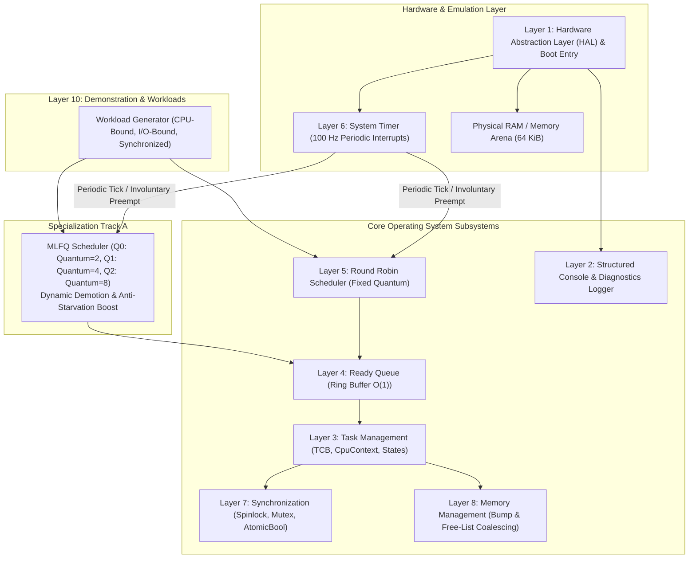
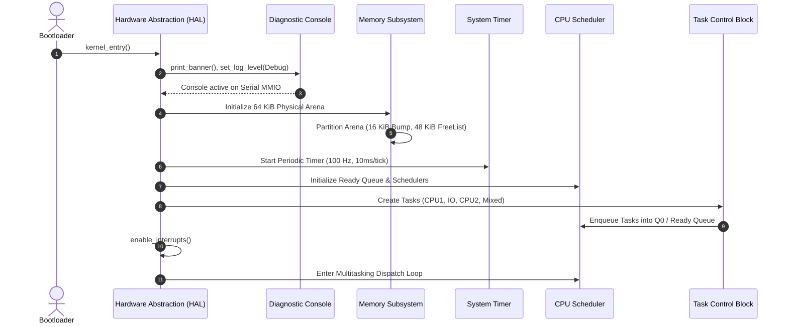
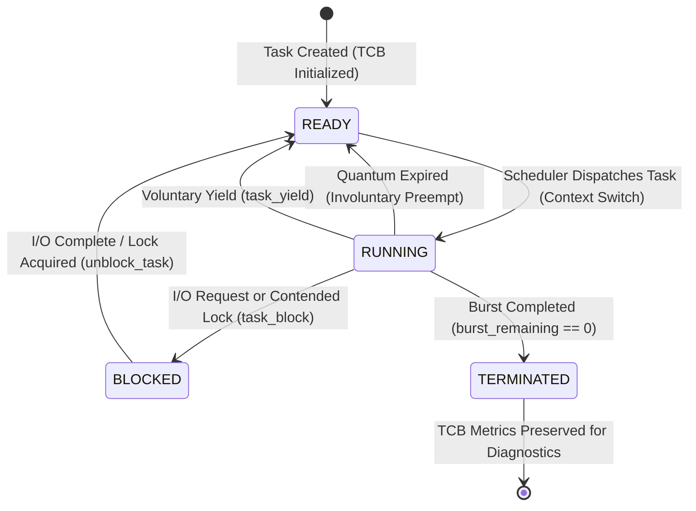
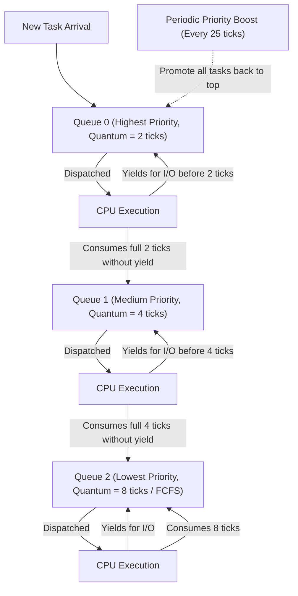

# Micro-OS System Architecture & Control Flow

## 1. Executive Summary

**Micro-OS** is an educational operating system kernel engineered in Rust for the CA-6 Systems Engineering flagship assessment. It provides an explicit, visible demonstration of core operating-system mechanisms: bare-metal bootstrap, structured diagnostics, task control blocks, ready queues, timer-driven preemption, mutual-exclusion synchronization, and dynamic memory allocation with block coalescing.

In addition to the 10 Core layers, this implementation incorporates **Specialization Track A: Scheduler Engineering**, featuring a full **Multi-Level Feedback Queue (MLFQ)** scheduler with dynamic priority demotion, I/O-friendly retention, and periodic anti-starvation priority boosting (aging).

---

## 2. Complete Layered Architecture



---

## 3. Kernel Boot & Initialization Control Flow (Layer 1 & 2)

The execution flow begins with early hardware initialization and advances incrementally through memory partitioning, timer activation, and task dispatching:



---

## 4. Task State Machine (Layer 3)

Tasks progress through four strict operational states: `READY`, `RUNNING`, `BLOCKED`, and `TERMINATED`:



---

## 5. Multi-Level Feedback Queue (MLFQ) Priority Flow (Track A)

The MLFQ specialization employs three priority queues with varying quanta to balance responsiveness and CPU throughput:



### MLFQ Governing Rules:
1. **Rule 1 (Priority Selection)**: If $\text{Priority}(A) < \text{Priority}(B)$, Task $A$ runs ($Q_0$ runs before $Q_1$, which runs before $Q_2$).
2. **Rule 2 (Round Robin within Queue)**: If $\text{Priority}(A) == \text{Priority}(B)$, Tasks $A$ and $B$ alternate in Round Robin using the queue's quantum.
3. **Rule 3 (Demotion on Quantum Expiry)**: If a task consumes its time allotment without relinquishing the CPU, it is demoted to the lower queue ($Q_0 \to Q_1 \to Q_2$).
4. **Rule 4 (I/O-Friendly Retention)**: If a task voluntarily yields CPU (e.g. initiating simulated I/O), it retains its priority level.
5. **Rule 5 (Priority Boost / Anti-Starvation)**: Every $S = 25$ ticks, all active tasks in the system are boosted back to $Q_0$. This prevents starvation for compute-intensive jobs and adapts if a task transitions from CPU-bound to interactive.

---

## 6. Memory Subsystem Layout (Layer 8)

The 64 KiB memory arena is partitioned into early-boot and dynamic regions:

```text
+------------------------------------+--------------------------------------------------+
|      Bump Allocator (16 KiB)       |           Free-List Allocator (48 KiB)           |
+------------------------------------+--------------------------------------------------+
| Sequential early boot structures   | Dynamic task buffers with header & coalescing    |
| (Page tables, TCB arrays, stacks)  | [Header][Payload] -> [Header][Payload] -> Free   |
+------------------------------------+--------------------------------------------------+
0x0000                               0x4000                                             0x10000
```

### Free-List Block Structure & Coalescing:
```text
+-----------------------+---------------------+-----------------------+---------------------+
| BlockHeader (24 B)    | Payload Data (N B)  | BlockHeader (24 B)    | Payload Data (M B)  |
| - magic: 0xDEADBEEF   |                     | - magic: 0xDEADBEEF   |                     |
| - size: N bytes       |                     | - size: M bytes       |                     |
| - is_free: bool       |                     | - is_free: bool       |                     |
| - next: *mut Header   |                     | - next: *mut Header   |                     |
+-----------------------+---------------------+-----------------------+---------------------+
```
When two contiguous blocks both have `is_free == true`, the allocator's `coalesce()` procedure merges them into a single larger block, resetting `size = N + size_of::<BlockHeader>() + M`, completely eliminating external fragmentation between adjacent allocations.
